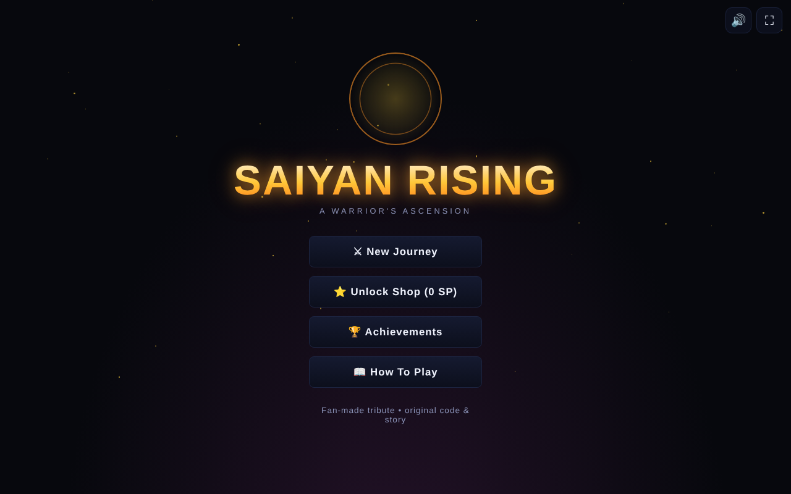
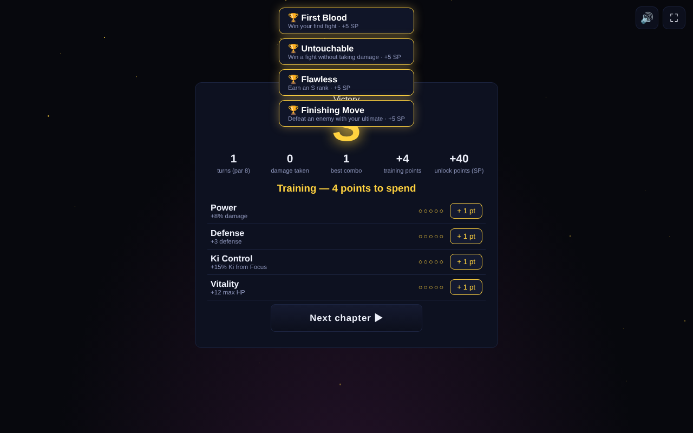
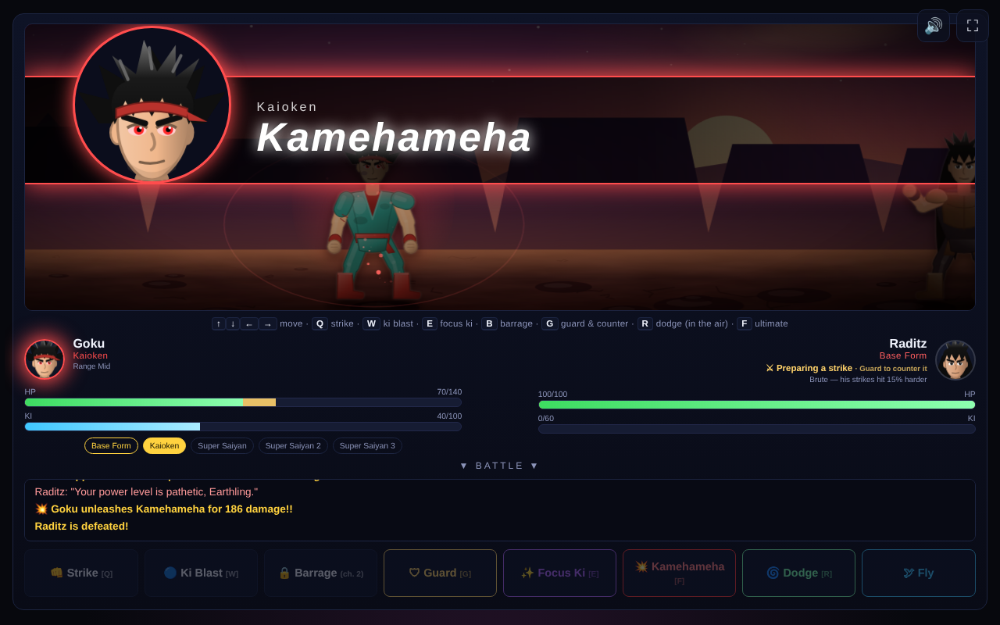

# Saiyan Rising

A single-file, browser-based story battle game. Pick a warrior, fight five escalating battles, unlock transformations, fly, dodge and unleash your ultimate. Fan-made tribute with original code, story and art.

**Play:** open `index.html` in any browser (no build step), or enable GitHub Pages (Settings → Pages → Deploy from branch → `main` / root) to host it.

## Controls
- Arrow keys: move (fly with up). Touch devices get an on-screen joystick.
- Q strike, W ki blast, B barrage (unlocks after chapter 1), G guard & counter, E focus ki, R dodge (in the air), F ultimate
- Unlockable attacks: X solar flare, C senzu bean, V meteor strike, Z power surge, H ki shield, N ki burst

## Features
- Telegraphed enemy moves, combo meter, guard/counter + stun, boss traits
- Cinematic ultimates, transformation sequences, dynamic camera, visible damage, craters
- Synthesized sound effects and adaptive music (mute button top right)
- Ranks, training upgrades, achievements, difficulty modes, saving, New Game+
- Unlock Shop: attacks, perks, aura colours and extra characters bought with SP earned from fights
